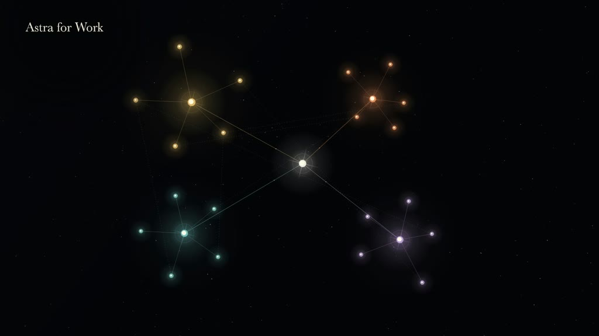

# Astra for Work

**一张小组汇报图的内容从哪里来？** 一条线通向 Teams 里的组员反馈，另一条通向 PAL 需求预测的模型结果。Astra for Work 把这样的交接画成可旋转的三维星图，也把同一组关系保存成可查询的 JSON。



An interactive 3D atlas of 20 recurring workflows. Each of the seven cross-group connections records what one task contributes to another. The same network can be explored in a browser, queried with Python, or used to plan a camera move.

## 四个阶段

| 阶段 | 项目名称 | 这一阶段回答什么问题 | 入口 |
| --- | --- | --- | --- |
| 01 | **staring技术学习** | 参考作品如何用分类、光环和镜头教人读图？最开始给过哪些技术指令？ | [技术笔记与提示词](learn/README.md) |
| 02 | **工作复盘是记录** | 怎样把日常工作分到四组，并记录哪一项向另一项提供了材料？ | [互动星图](atlas/index.html) · [工作分配与交接](atlas/README.md) |
| 03 | **passway extra work** | 怎样把星图的页面设计、空间坐标和业务关系整理为同一个可计算、可用于设计的模型？ | [模型说明](model/README.md) · [网络数据](model/network.json) · [模型画布](design/index.html) · [30 秒成片](media/astra-for-work-1080p60.mp4) · [运镜与配乐源码](media/render/README.md) |
| 04（可选） | **工作星图的导演剪辑版** | 怎样从复盘中抽取分类、输入、产出和交接，挑出能讲清一个案例的路线，做成 Starlink 演示？ | [50 秒导演剪辑](media/work-atlas-directors-cut.mp4) · [五幕分镜](media/README.md) |

第三阶段的原始定义是 *The model for network for calculation and for designing*。**Astra for Work** 是画布上的英文片名。阶段编号表示工作方法的层次，第四阶段可以按展示需要选用。

## 先打开，再查询

1. 下载并解压仓库，用浏览器打开 **`atlas/index.html`**。点「查看全图」，再从左侧目录选择「Teams 小组协作」，点击详情里的「组员反馈 → 讲稿转场」。
2. 在仓库根目录运行以下命令。同一次查询会标出每一段的方向和交接理由。

   ```sh
   python3 tools/network.py validate
   python3 tools/network.py path teams pal
   ```

   两项工作的连接是 **Teams → 演示设计 ← PAL**。第一段表明反馈进入演示稿制作，第二段从演示稿反向查到模型结果。换成 `python3 tools/network.py path pal slides --mode flow` 可以只看顺着工作流成立的路径。

3. 要看第三阶段的纯星图设计，在仓库根目录运行 `python3 -m http.server 8000 --bind 127.0.0.1`，然后打开 [本机模型画布](http://127.0.0.1:8000/design/)。画布读取 `model/network.json`，可拖动旋转并缩放。第二阶段的离线 HTML 自带数据，作为当时业务分配的快照保留。

## 数字如何核对

四类工作分别是办公协作、创意设计、课程学习和求职发展，各 5 项。加上 4 个分类中心和白色 Codex 根节点，全图有 **25 个节点**。其中 **24 条归属关系**组成目录，另有 **7 条有用途说明的跨组关系**，合计 **31 条连线**。坐标记录初始布局，工时、频次和优先级可以在取得相应记录后另行建模。

## 许可

本仓库的原创代码、文档和示例网络数据采用 [MIT 许可证](LICENSE)。两支视频、其中的原创配乐和预览图采用 [CC BY 4.0](https://creativecommons.org/licenses/by/4.0/)。署名可写作 **Astra for Work contributors**，附本仓库链接。学习笔记中链接的参考项目各自提供其许可证。
