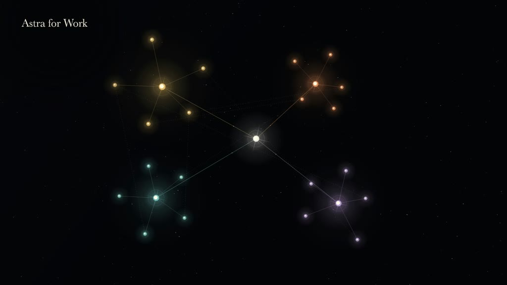

# 从数据模型到两种剪辑

两段成片取材于同一张工作星图，均含原创立体声配乐。下载 MP4 后可用支持 AV1 的浏览器或本地播放器观看。

| 阶段与用途 | 文件 | 规格 |
| --- | --- | --- |
| 第三阶段 · passway extra work 的视觉呈现 | [Astra for Work](astra-for-work-1080p60.mp4) | 30 秒，1920 × 1080，60 fps |
| 可选第四阶段 · 工作星图导演剪辑版 | [工作星图导演剪辑版](work-atlas-directors-cut.mp4) | 50 秒，1280 × 720，30 fps，含画内中文讲解 |

## 第三阶段 · 黑色画布上的模型

白色节点代表 Codex，其余四种颜色对应办公协作、创意设计、课程学习与求职发展。这个版本取用互动星图的节点位置和连线，将整个画幅留给空间。镜头从全景推近金色节点，横移经过橙色和青色星团，最后从紫色星团退回全景。画面仅保留英文片名 **Astra for Work**。计算使用的节点和边可在[网络模型](../model/README.md)中读取。要修改镜头或重新生成原配乐，可使用[渲染源码与导出说明](render/README.md)。

## 可选第四阶段 · 把工作复盘讲成一段路程

从每条工作记录里提取所属分类、留下的输入或产出，以及使用这份材料的后续环节。剪辑从 7 条有说明的跨组关系中选出 2 条，让观众沿着一次小组汇报读图。

| 时间 | 镜头 | 要看懂的关系 |
| --- | --- | --- |
| 00–10 秒 | 展开整张图 | 20 项工作、4 个分类中心与 1 个白色根节点，共 25 个节点。 |
| 10–20 秒 | 推近金色 Teams 节点 | 结合左侧目录，找出节点所属的办公协作组。 |
| 20–30 秒 | 拉远，让金色和橙色同时入画，再沿虚线横移 | 小组反馈进入演示稿制作，用于调整讲稿和页面转场。 |
| 30–40 秒 | 从橙色演示节点追溯到青色 PAL 节点 | PAL 需求预测的模型比较结果为小组汇报提供图表内容。 |
| 40–50 秒 | 掠过紫色求职组，回到全图 | 远景读分类，近景找工作，跨组虚线追踪材料去向。 |

制作时从[互动星图](../atlas/index.html)读取节点、分类和跨组边，沿预设的相机路径逐帧渲染。光点沿选中的连线移动，用于指示画面正在讲哪一条关系。五幕时间记录的是镜头节奏。两支影片共用工作关系，各自独立播放。
